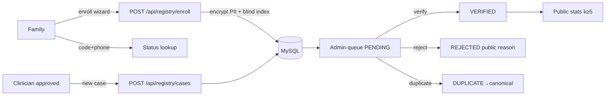

# PRD — NVAR: National Vascular Anomaly Registry (Pakistan)

**Product:** NVAR, a module of the PSOVA website
**Status:** Approved for implementation · **Owner:** PSOVA (Dr Faisal Maqsood Anwar)
**Repo:** `github.com/jerryboganda/psova` · **Host:** Hostinger Business (hPanel)

---

## 1. Vision

Pakistan has no national dataset of vascular anomaly patients. Families struggle to find care;
clinicians and policymakers have no prevalence data; research is impossible. NVAR is
**Pakistan's first national registry of vascular anomaly cases**: families and clinicians
enroll cases, PSOVA verifies them, and the nation gets an anonymized, public statistics
dashboard — while every patient's identity stays encrypted and protected.

**Tagline (public page):** "Counted. Cared for. — Pakistan's first national picture of
vascular anomalies."

## 2. Goals & success metrics

| Goal | Metric (12 months) |
|---|---|
| Build the national dataset | ≥ 1,000 verified records across all provinces |
| Clinical participation | ≥ 25 approved clinicians submitting cases |
| Data quality | ≥ 90% of verified records with condition + province + age |
| Public transparency | Statistics dashboard live, updated automatically |
| Zero data incidents | 0 PII leaks; 100% of PII access audit-logged |

## 3. Non-goals (v1)

- No patient user accounts (tracking code instead)
- No photo/document uploads (PII/consent risk — v2)
- No appointment booking or telemedicine
- No public access to any row-level data — aggregates only
- No third-party analytics on registry pages
- No CNIC-based public lookup

## 4. Personas

1. **Ayesha — parent/guardian (primary).** Urdu-first, mobile-first, low technical literacy.
   Her infant has a hemangioma. Needs: enroll in <10 minutes, in Urdu, without creating an
   account; get proof of enrollment; be contacted about care if she consents.
2. **Dr Imran — clinician.** Pediatric surgeon at a public hospital. Needs: an account,
   fast structured case submission (ISSVA classification), list of his submitted cases.
3. **PSOVA Admin.** Society staff. Needs: verification queue, full decrypted record view,
   verify/reject/duplicate actions, clinician approval, CSV export for the medical board,
   audit trail.
4. **Public / researcher / policymaker.** Needs: trustworthy anonymized national statistics.

## 5. User stories & acceptance criteria

### Epic A — Public registry pages

**A1. Registry landing (`/[locale]/registry`)**
As a visitor I understand what the registry is, why it matters, my privacy rights, and can
start enrollment or check status.
- AC: bilingual, RTL-correct; explains purpose, who can enroll, privacy summary (encryption,
  consent, right to removal); CTAs → Enroll, Check status, Statistics; clinician login link;
  medical disclaimer; looks native to site design.

**A2. Patient enrollment wizard (`/[locale]/registry/enroll`)**
As a family I enroll a patient in a 5-step wizard without an account.
- Step 1 Patient: full name, gender, date of birth, guardian name (required if minor)
- Step 2 Contact: phone (required), alt phone, email (optional), CNIC of patient or guardian
  (required, 13 digits, dashes auto-formatted), province, district/city, address
- Step 3 Condition: condition (8 site conditions + "Other/Not sure"), affected body area,
  onset (birth / infancy / childhood / adult), "diagnosed by a doctor?" (yes/no/unsure),
  diagnosing facility (optional), current/past treatments (free text, optional)
- Step 4 Consent: required consent to store encrypted data for the registry; optional consent
  to be contacted about care; optional consent for anonymized research use; guardian
  declaration when minor. Links to privacy policy section.
- Step 5 Review → submit
- AC: RHF+Zod per step; back/next preserves state; errors bilingual; honeypot anti-spam field;
  rate-limited API; on success shows **tracking code** (`PSV-XXXX-XXXX`) with copy button,
  "save this code" warning, status-check link; confirmation email sent if email given & SMTP
  configured. All PII encrypted before storage (see SECURITY.md). Duplicate CNIC blind-index
  hit does NOT block submission — record is flagged `possibleDuplicate` for admin.

**A3. Status lookup (`/[locale]/registry/status`)**
As an enrollee I check my application with tracking code + phone.
- AC: form (tracking code + phone); match via code + phone blind index; shows status
  (Pending review / Verified / Needs more info (rejected with public reason) ) + submitted
  date + first name only; never exposes full PII; rate-limited (10/hr/IP); invalid → generic
  "not found" (no enumeration).

**A4. Public statistics (`/[locale]/registry/statistics`)**
As anyone I see the national picture.
- AC: cards (total verified cases, provinces covered, participating clinicians, conditions
  tracked); charts (SVG/CSS, no chart lib): cases by province (map-style bar list), by
  condition, by gender, by age band, enrollments over time; **every displayed count ≥ 5,
  otherwise "<5"**; only VERIFIED records counted; bilingual; revalidated hourly; "data
  disclaimer" note.

### Epic B — Clinician portal

**B1. Auth (`/[locale]/registry/login`)**
Email/password login (Better Auth). Clinician self-registration with: name, email, password,
PMDC/PMC registration number, specialty, facility, city, province → account created with
`ClinicianProfile.approved = false`.
- AC: unapproved clinicians see a "pending approval" screen, cannot submit cases; admin role
  never self-registrable; generic error messages (no user enumeration); rate-limited.

**B2. Case submission (`/[locale]/registry/clinician/new-case`)**
Structured clinical form: patient demographics + contact (same as A2 steps 1–2, patient
consent attestation checkbox instead of interactive consent), diagnosis: condition slug,
**ISSVA category** (benign tumor / borderline / malignant / simple malformation / combined /
major vessel / syndromic), site(s), severity (mild/moderate/severe), basis of diagnosis
(clinical / imaging / histology), treatments given (structured: type + facility + year +
outcome, repeatable), clinical notes (encrypted).
- AC: submits as `source: CLINICIAN`, status PENDING (admin still verifies), linked to
  clinician; tracking code generated and shown (clinician gives it to family).

**B3. My cases (`/[locale]/registry/clinician`)**
- AC: table of own submissions (tracking code, patient first name, condition, status, date);
  no other clinicians' data; detail view shows own submission decrypted (audit-logged).

### Epic C — Admin dashboard (`/[locale]/registry/admin`)

**C1. Overview:** stat cards (pending, verified, rejected, clinicians awaiting approval),
recent submissions list.
**C2. Verification queue:** PENDING records, oldest first; filters (province, condition,
source); row → detail.
**C3. Record detail:** full decrypted record (audit event `RECORD_VIEW_PII` on open);
possible-duplicate banner (same CNIC/phone blind index) with links; actions: **Verify**,
**Reject (with reason: public note + internal note)**, **Mark duplicate (link to canonical
record)**; edit non-PII clinical fields; every action audit-logged.
**C4. All records:** filter status/province/condition/source/date; exact search by CNIC,
phone, or tracking code (via blind index — no partial PII search possible by design).
**C5. Clinician approvals:** list registrations, view profile, Approve/Reject (audit-logged;
approval email sent if SMTP configured).
**C6. CSV export:** filtered export of decrypted records for the medical board; confirmation
dialog stating the export is audit-logged (`EXPORT_CSV`, includes row count + filters).
**C7. Audit log viewer:** filterable by actor/action/date; read-only.
- AC (all): admin-role only (server-enforced); bilingual UI (English-first acceptable for
  admin, keys still in messages files); responsive.

### Epic D — Platform integration

- "Registry" added to site navigation (`data/navigation.ts` + Nav messages) and footer.
- Home page: registry CTA section (small, links to `/registry`).
- Privacy/consent copy lives on registry landing (v1; standalone policy page optional).
- Sitemap: add public registry routes (`/registry`, `/registry/statistics`, `/registry/enroll`,
  `/registry/status`); admin/clinician routes excluded, `robots` disallow `/registry/admin`
  and `/registry/clinician`.

## 6. Key flows

## 7. Data policy summary (details in SECURITY.md)

- PII (names, CNIC, phones, email, address, exact DOB, clinical notes) — **AES-256-GCM
  encrypted at rest**, decrypted only for admin review/export and clinician-own-case view.
- Dedup/lookup via HMAC-SHA256 blind indexes (CNIC, phone).
- Consent captured with timestamp + wizard version; right to removal via PSOVA contact
  channels (admin deletes/anonymizes — v1 manual).
- Public outputs: aggregates only, k-anonymity threshold 5.

## 8. Rollout

Phase order per `TASKS.md` (P1 foundation → P8 ship). Launch checklist: seed admin, approve
first clinicians, verify SMTP, run DEPLOYMENT-HOSTINGER.md runbook, smoke-test enroll→verify→
stats on production, then announce.

## 9. Open questions (defaults chosen, revisit post-v1)

- Exact-DOB vs month/year for self-enrollment → **full DOB** (owner decision, encrypted).
- SMS notifications (no reliable free PK gateway) → **email-only v1**.
- Urdu clinical terminology review → native-speaker pass before public launch.
